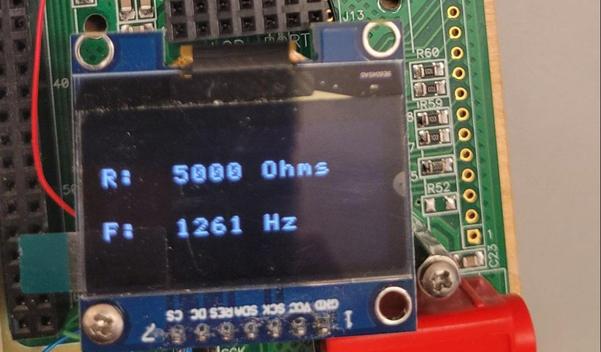
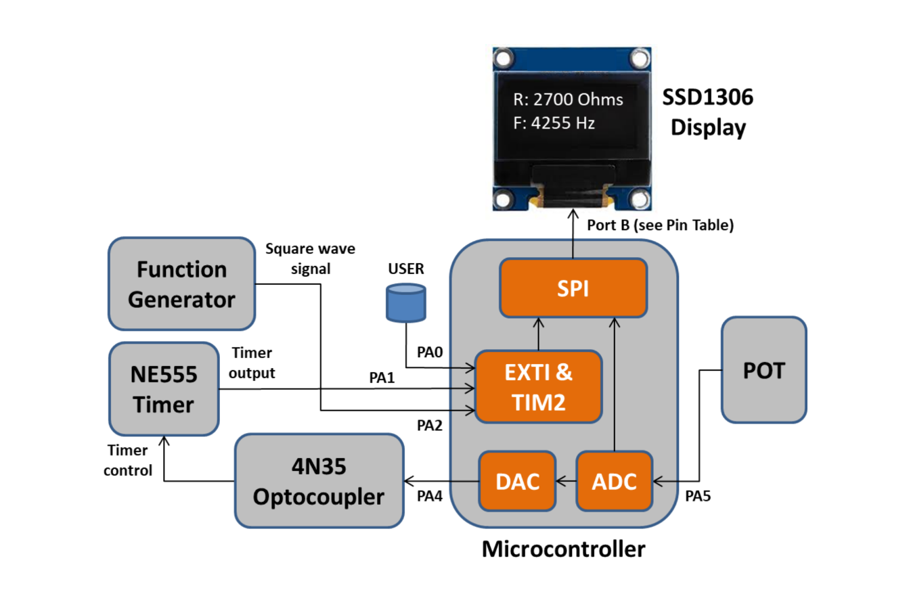
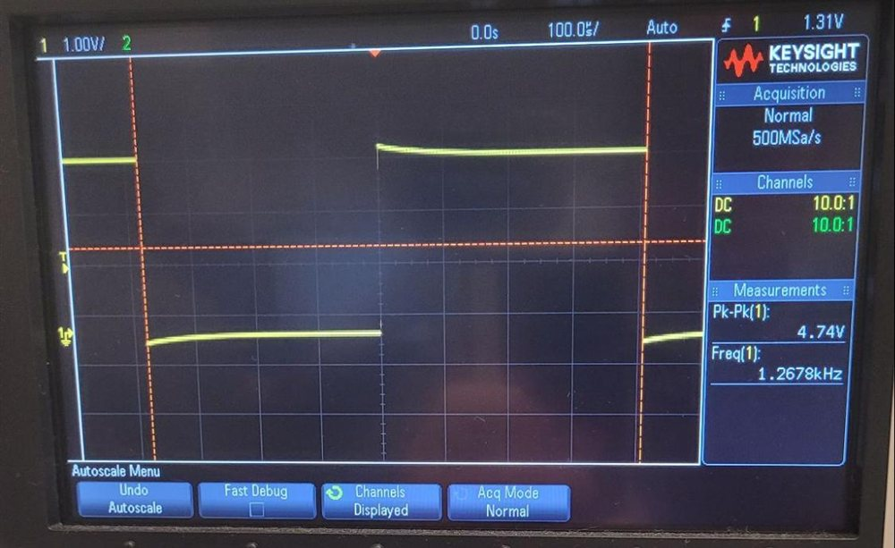

# Embedded PWM Signal Monitoring and Control System

A bare-metal embedded system on an **STM32F051** microcontroller (STM32F0 Discovery board), built with Connor Wiebe at the University of Victoria. It senses a potentiometer, closes a control loop to set a 555 timer's PWM frequency, measures the resulting signal, and displays everything live on an OLED screen.

## Features

- **Interrupt-driven frequency measurement:** external interrupts and a hardware timer (TIM2) time signal edges to compute frequency. The USER button toggles between measuring the 555 timer and an external function generator.
- **ADC sensing:** the ADC continuously polls the potentiometer voltage (0.7–3.3 V) and converts it to resistance (0–5 kΩ).
- **Closed-loop frequency control:** the DAC drives a 4N35 optocoupler, which adjusts the 555 timer's frequency and duty cycle in response to the potentiometer.
- **SPI OLED display:** a custom SSD1306 driver over SPI refreshes the measured frequency and resistance on the display.

## Validation

Each subsystem was checked against bench equipment. For example, the system displayed **1261 Hz** while the oscilloscope measured **1.2678 kHz**, within about 0.5%.

| Measurement | Range |
| --- | --- |
| 555 timer frequency | ~800–1300 Hz |
| Function generator frequency | 300 Hz–380 kHz |
| DAC output | 0.92–1.97 V |
| Potentiometer resistance | 0–5 kΩ |

## Project layout

| Path | Contents |
| --- | --- |
| `src/main.c` | Application code: GPIO/timer/EXTI/ADC/DAC/SPI setup, interrupt handlers, OLED driver, and main loop |
| `include/`, `ldscripts/` | HAL configuration and linker scripts |
| `system/` | CMSIS and STM32F0 HAL support code (GNU ARM Eclipse template) |
| `docs/PWM_Control_Lab_Report.pdf` | Full lab report with design rationale and test results |

The project was built with the GNU ARM Eclipse toolchain. Import the folder as an existing Eclipse project to build and flash.

## Authors

**Benjamin Philipenko** · [benphilipenko.ca](https://benphilipenko.ca/embedded-pwm-control) and Connor Wiebe
